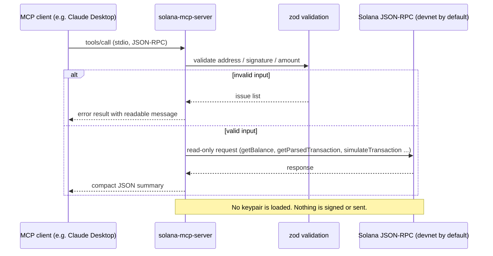

<h1 align="center">solana-mcp-server</h1>

<p align="center">
  Give AI agents safe, read-only access to Solana through the Model Context Protocol.
</p>

<p align="center">
  
  
  
  
</p>

## Overview

`solana-mcp-server` is a [Model Context Protocol](https://modelcontextprotocol.io) server that lets
MCP clients such as Claude Desktop query the Solana blockchain. An agent can check balances, list
SPL token holdings, read a transaction in compact form, browse recent activity and dry-run a SOL
transfer. The server is read-only by design: it never holds a private key, never signs and never
broadcasts anything, so you can plug it into an agent without handing over a wallet.

## Features

- **`get_balance`**: native SOL balance in lamports and SOL, computed with exact integer math.
- **`get_token_accounts`**: SPL Token and Token-2022 accounts, with mint, raw amount and decimals.
- **`get_transaction`**: a compact transaction summary (status, fee, signers, programs, SOL and token balance changes, optional logs).
- **`recent_activity`**: latest signatures for an address, with cursor-based pagination.
- **`simulate_transfer`**: builds an unsigned SOL transfer and runs `simulateTransaction`, returning logs, compute units and fee.
- Strict input validation with zod: base58 addresses and signatures are checked before any RPC call.
- Uses devnet by default; mainnet or any custom RPC is selected with a single environment variable.
- Readable error messages for agents instead of stack traces.

## Architecture



## Quickstart

Requires Node.js 20.18 or newer.

```bash
git clone https://github.com/wonghldev/solana-mcp-server.git
cd solana-mcp-server
npm ci
npm run build
npm test
```

Try it interactively with the MCP Inspector:

```bash
npx @modelcontextprotocol/inspector node dist/index.js
```

Use it from Claude Desktop: copy the block from
[`examples/claude_desktop_config.json`](examples/claude_desktop_config.json) into your
`claude_desktop_config.json`, replace the path with the absolute path to `dist/index.js` and
restart Claude Desktop.

Run it with a local `.env` file:

```bash
cp .env.example .env
npm run start:env
```

## Configuration

All variables are optional. Empty values fall back to the defaults.

| Name | Required | Default | Description |
| --- | --- | --- | --- |
| `SOLANA_RPC_URL` | No | `https://api.devnet.solana.com` | JSON-RPC endpoint. Set a mainnet or provider URL to leave devnet. |
| `SOLANA_COMMITMENT` | No | `confirmed` | Commitment for reads: `processed`, `confirmed` or `finalized`. |
| `SOLANA_REQUEST_TIMEOUT_MS` | No | `30000` | Timeout for each RPC request, from 1000 to 120000 ms. |

## Security Model

- **Read-only.** All tools are annotated with `readOnlyHint` and only call read or simulation RPC methods.
- **No keys.** The server never loads a keypair, seed phrase or wallet file, and there is no setting to add one.
- **No signing.** `simulate_transfer` builds a transaction with empty signature slots and simulates it without verifying signatures. It cannot be broadcast.
- **Validated input.** Addresses, signatures and amounts are validated before they reach the RPC node; SOL amounts use integer lamport math, never floating point.
- **Minimal logging.** Diagnostics go to stderr only. Query strings in the RPC URL, where providers often put API keys, are redacted.

What it does not protect against: an RPC provider can still see the addresses you query, and
data returned by a third-party RPC endpoint is trusted as-is.

## Project Structure

```text
solana-mcp-server/
├── examples/
│   └── claude_desktop_config.json
├── src/
│   ├── tools/
│   │   ├── getBalance.ts
│   │   ├── getTokenAccounts.ts
│   │   ├── getTransaction.ts
│   │   ├── recentActivity.ts
│   │   └── simulateTransfer.ts
│   ├── index.ts
│   ├── solana.ts
│   └── validation.ts
├── tests/
│   ├── transaction.test.ts
│   └── validation.test.ts
├── .env.example
├── .gitignore
├── LICENSE
├── README.md
├── package-lock.json
├── package.json
├── tsconfig.json
└── vitest.config.ts
```

## Roadmap

- [x] SOL balance, SPL / Token-2022 accounts, transaction summary, recent activity
- [x] Unsigned transfer simulation with fee and compute units
- [x] Input validation and unit tests
- [ ] Token metadata (name, symbol) for known mints
- [ ] Simulation of SPL token transfers
- [ ] Streamable HTTP transport in addition to stdio
- [ ] Response caching and rate limiting for public RPC endpoints

## Status

Experimental — devnet only, not audited.

## Disclaimer

This is experimental software provided as-is, without warranty. It is not financial advice.
Verify any on-chain data independently before relying on it.

## License

[MIT](LICENSE)
